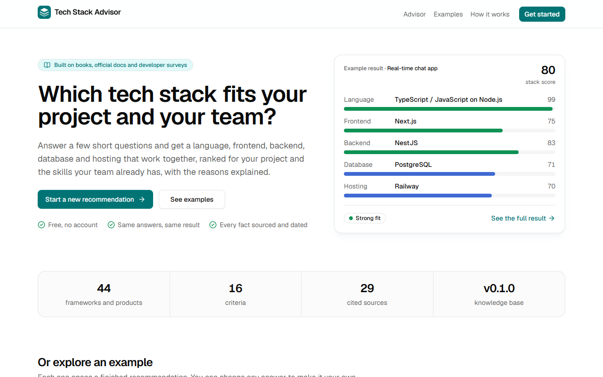
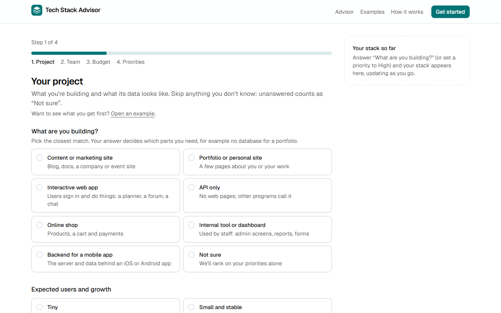
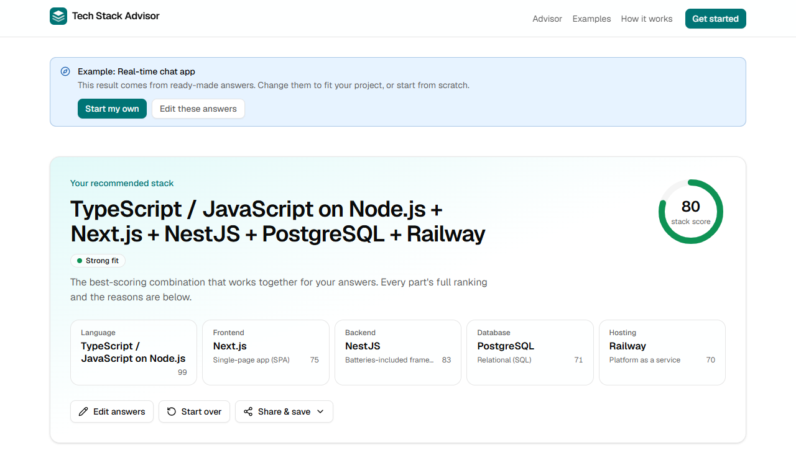
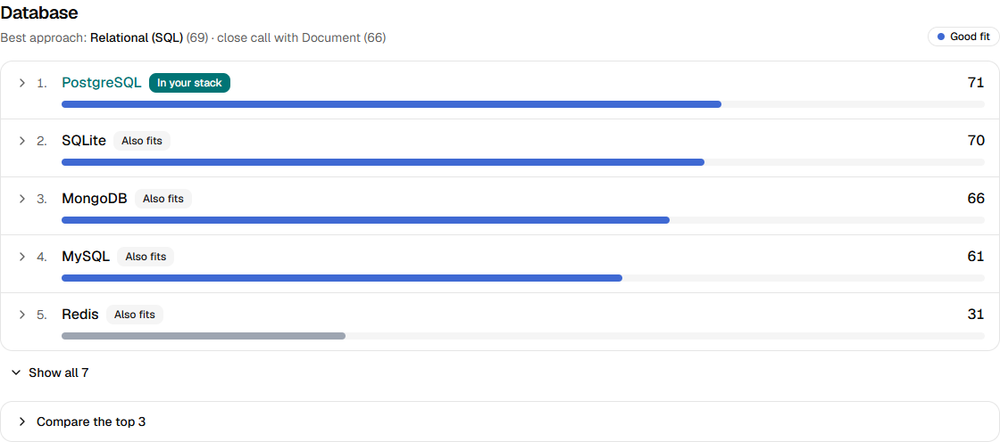

# Tech Stack Advisor

A free web app that recommends a **tech stack** for a software project: a language, frontend, backend, database and hosting that work together, ranked for your project and the skills your team already has, with the reasons explained.

It is the sibling of **[Architecture Advisor](https://github.com/lochana-dahanayake/architecture-advisor)** ([live](https://architecture-advisor-pink.vercel.app)), which recommends _architecture styles_. Tech Stack Advisor answers the next question: "I picked a style, now which tools should I build it with?" A style chosen there can be carried over with `/advisor?style=<id>`.

**Status:** v0.4.0 preview. Not deployed yet (Phase 5, `docs/ROADMAP.md`).

|                                                               |                                                                        |
| ------------------------------------------------------------- | ---------------------------------------------------------------------- |
|                  |           |
|  |  |

## How it works

1. You answer four short steps: what you're building, your team and timeline, budget and rules (including "we must use X"), and what matters most.
2. A **deterministic rule engine** scores every option from a curated **knowledge base**: 1–5 scores per criterion, each with a source (books, official docs, developer surveys) and the date it was checked. It picks the approach for each part first (for example "relational" before "PostgreSQL"), applies team-skill and constraint rules, and assembles the best combination that works together. Same answers, same result.
3. An **optional AI explanation** (free tiers of Google Gemini, then Groq) explains the stack in plain words. It may nudge at most three options by ±5 points with a visible reason; the engine then rebuilds the stack, so the AI can tip a close call but never picks the stack or builds the comparison. The app works fully with AI off.

Every rule, source and date is on the app's **How it works** page; what is sent where is on its **Privacy** page.

## Run it locally

Needs Node.js 20.9 or later (Next.js 16's minimum).

```sh
npm ci
npm run dev            # http://localhost:3000, AI off
npm run check          # lint, typecheck, format, boundary rules, unit tests with coverage
npm run build && npm run test:e2e   # end-to-end and accessibility tests (Playwright)
npm run calibrate      # prints the calibration tables the docs quote
```

To try the AI explanation without any key, set `AI_MODE=mock` in `.env.local`. For real explanations, copy `.env.example` to `.env.local`, add free keys from Google AI Studio and GroqCloud, and set `AI_MODE=live`. Keys are server-only: never prefix them with `NEXT_PUBLIC_`.

Retake the screenshots and the link-preview image with `node scripts/screenshots.mjs` (start the app on port 3100 first; uses the installed Edge, or pass `chrome` as the second argument).

## Deploy (Vercel Hobby, free)

Import the GitHub repo in Vercel (framework: Next.js, no build settings to change) and set `AI_MODE=off`, or `live` with `GEMINI_API_KEY` and `GROQ_API_KEY`. Every push to `main` then redeploys. Details and the launch checklist: `docs/DEPLOY.md`.

## Repo map

| Folder                      | What's in it                                                                                                  |
| --------------------------- | ------------------------------------------------------------------------------------------------------------- |
| `docs/`                     | The plan and spec; the docs are the source of truth. Start with `CLAUDE.md`, then `docs/PROJECT_OVERVIEW.md`. |
| `docs/adr/`                 | Architecture Decision Records.                                                                                |
| `src/modules/`              | `knowledge-base` (JSON + Zod schema), `scoring` (the pure engine), `recommendation`, `ai`, `platform`.        |
| `src/app`, `src/components` | The Next.js app: landing, advisor form and result, methodology, about, privacy, changelog, `/api/explain`.    |
| `tests/`                    | KB, engine, golden scenarios, property tests, AI layer with mocked providers, API route, UI state, e2e + axe. |
| `references/`               | Source material for knowledge-base rules (reading only).                                                      |

## Sources

The source code is public so anyone can check how results are made (no licence file has been chosen yet). Scores cite published books and articles, official documentation and developer surveys (see the How it works page); copyrighted references are summarised, never copied.
